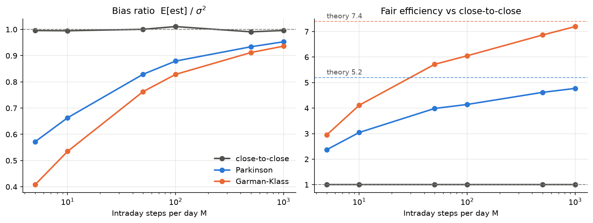

# crossasset-vol

[](https://github.com/aymanebouhsain-lgtm/crossasset-vol/actions/workflows/tests.yml)

Forecasting next-week realized volatility across five asset classes using daily
OHLC (open, high, low, close) data. The project builds daily variance estimates
from price ranges and returns, and will compare forecasting models for the
average volatility over the following five trading days on five liquid ETFs:
SPY, TLT, FXE, GLD and USO.

## Assets

| Ticker | Asset class | Instrument                          |
|--------|-------------|-------------------------------------|
| SPY    | Equities    | SPDR S&P 500 ETF Trust              |
| TLT    | Rates       | iShares 20+ Year Treasury Bond ETF  |
| FXE    | FX          | Invesco CurrencyShares Euro Trust   |
| GLD    | Gold        | SPDR Gold Shares                    |
| USO    | Oil         | United States Oil Fund              |

Daily data from January 2007 onwards, downloaded with `yfinance` (prices
adjusted for splits and dividends).

## Current status

- **Data pipeline** (`src/volforecast/data.py`): downloads daily OHLCV data
  for the five ETFs and stores it locally as Parquet files.
- **Volatility estimators** (`src/volforecast/estimators.py`): four daily
  variance estimators:
  - close-to-close (squared log return),
  - overnight (squared close-to-open log return),
  - Parkinson (high-low range),
  - Garman-Klass (high-low range and open-to-close return).

  The range-based estimators (Parkinson, Garman-Klass) can optionally add the
  overnight term, so that they cover the full close-to-close day.
- **Monte Carlo validation** (`src/volforecast/simulate.py`,
  `notebooks/03_monte_carlo.ipynb`): simulates daily OHLC bars from an intraday
  Brownian motion and measures the bias and efficiency of each estimator
  against the known true variance. Summary below.

## Estimator validation (Monte Carlo)

Daily OHLC bars are simulated from a driftless Brownian motion in log price,
observed at M equally spaced points per day, with no overnight gap (20,000 days,
daily volatility 1%). The true daily variance is known, so each estimator can
be checked against it.



- Close-to-close is unbiased at every M (bias ratio 0.99 to 1.01).
- Parkinson and Garman-Klass are biased low, because the observed high and low
  miss the true extremes between observations. Their bias ratio is 0.57 / 0.41
  at M = 5 and still 0.95 / 0.94 at M = 1000.
- The bias shrinks like M^(-1/2), as predicted by Broadie, Glasserman and Kou
  (1997): the fitted log-log slopes are -0.479 (Parkinson) and -0.465
  (Garman-Klass), averaged over 5 seeds for M = 50 to 1000.
- Measured on squared coefficients of variation, the efficiency relative to
  close-to-close at M = 1000 is 4.8 (Parkinson) and 7.2 (Garman-Klass), below
  the continuous-path values 5.2 and 7.4. The plain variance ratio overstates
  the gain for biased estimators (17.5 for Garman-Klass at M = 5, against 2.9).

On real data, prices are also observed at discrete trades, so range-based
estimators will tend to understate volatility, more so for less liquid assets.

## Roadmap

1. [x] Monte Carlo validation of the estimators on simulated price paths
2. [ ] HAR-RV baseline model
3. [ ] Walk-forward out-of-sample evaluation using the QLIKE loss
4. [ ] GARCH-family models
5. [ ] LightGBM model
6. [ ] Daily live forecasting job

## Results

Coming soon.

## Setup

```bash
git clone https://github.com/aymanebouhsain-lgtm/crossasset-vol.git
cd crossasset-vol

python -m venv .venv
source .venv/bin/activate        # Windows: .venv\Scripts\activate

pip install -r requirements.txt
python src/volforecast/data.py   # downloads data into data/
```

Run the tests and the linter/formatter with:

```bash
pytest
ruff check .     # lint
ruff format .    # format
```

The test suite contains an import smoke test and Monte Carlo tests of the
simulator and estimators (fixed seed). CI runs it on every push with
Python 3.12.

## Repository structure

```
crossasset-vol/
├── .github/workflows/
│   └── tests.yml           # CI: runs pytest on push
├── src/volforecast/
│   ├── __init__.py
│   ├── data.py             # download and load daily OHLCV data
│   ├── estimators.py       # daily variance estimators and annualization
│   └── simulate.py         # simulated OHLC bars for Monte Carlo tests
├── notebooks/
│   ├── 01_explore.ipynb    # first look at the data
│   ├── 02_estimators.ipynb # comparing estimators on SPY
│   └── 03_monte_carlo.ipynb # Monte Carlo validation of the estimators
├── tests/
│   ├── test_smoke.py       # placeholder import test
│   └── test_estimators.py  # Monte Carlo tests of simulator and estimators
├── figures/                # figures saved by the notebooks
├── data/                   # Parquet files created by data.py (not tracked)
├── pyproject.toml          # pytest and ruff configuration
├── requirements.txt
└── LICENSE
```

## License

MIT. See [LICENSE](LICENSE).
